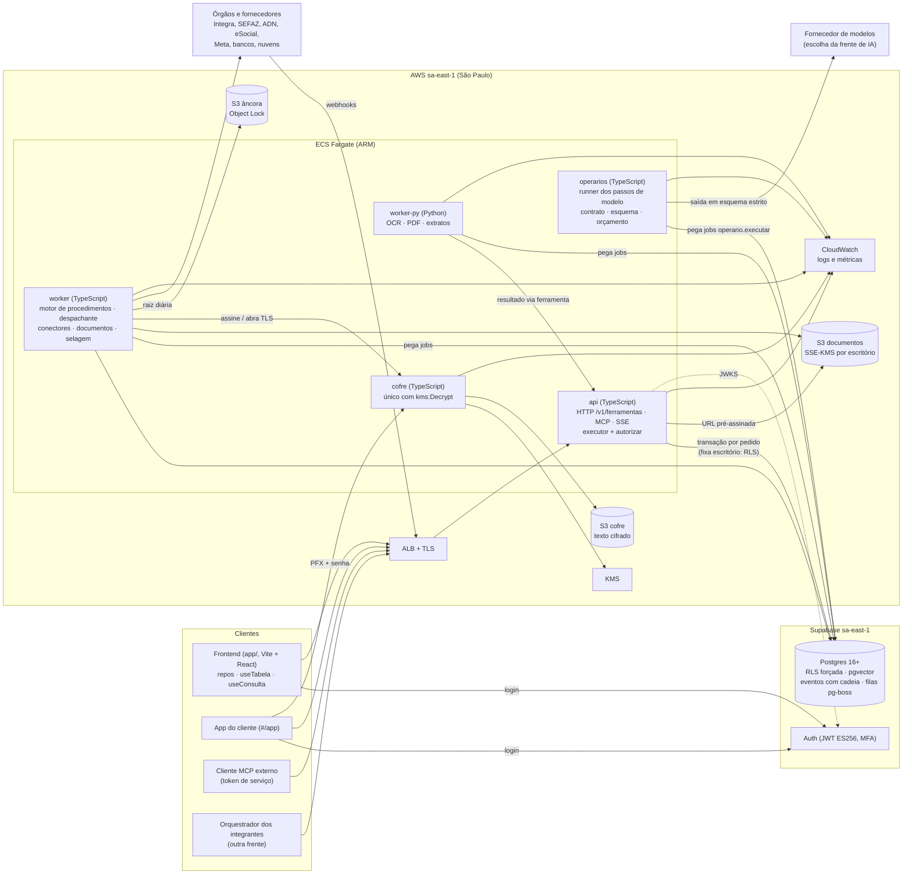
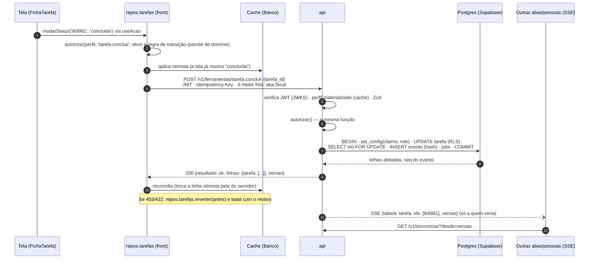
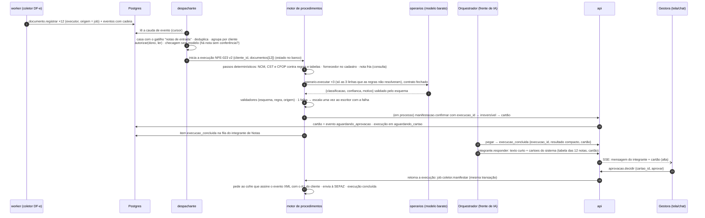

# Arquitetura do backend real

**Versão 0.2 · 15/11/2026 · desenho.** Os serviços, o caminho de um pedido da tela e de um agente, a implantação e a migração do wireframe para o backend real em fases. A versão 0.2 acrescenta o motor de procedimentos e o runner de operários, que a avaliação dos integrantes pede ao backend (`docs/integrantes/AVALIACAO.md`, seção 9, no branch `wf-integrantes-pesquisa`). As decisões de stack estão em [`STACK.md`](STACK.md), a hospedagem em [`HOSPEDAGEM.md`](HOSPEDAGEM.md) e o contrato das ferramentas em [`AGENTICO.md`](AGENTICO.md).

## 1. Os serviços



| Serviço | Responsabilidade | Escala |
| --- | --- | --- |
| `api` | Ferramentas por HTTP e MCP, executor, `autorizar`, SSE de mudanças, webhooks de entrada, emissão do token de integrante, `/v1/sessao`, `/v1/sincronizar` | Horizontal, sem estado (o cache de perfil é por processo e invalidado por evento) |
| `worker` | **Motor de procedimentos** (fila `procedimento.passo`: passos determinísticos, validadores, escalada, consolidação de lote, retomada após cartão ou espera externa); filas `coletor.*`, `documento.processar`, `notificacao.entregar`, `selagem.*`; o **despachante** de eventos para gatilhos e procedimentos; agenda (cron) | Horizontal; concorrência limitada por escritório e por órgão |
| `operarios` | **Runner dos passos de modelo** (fila `operario.executar`): monta a entrada só com o contrato, chama o modelo com saída em esquema estrito, valida, confere o orçamento antes de cada chamada e grava `chamada_modelo` ([`AGENTICO.md`](AGENTICO.md), 4.3). É a mesma imagem do `worker`, como serviço separado: só ele tem a chave do fornecedor de modelos, e ele escala pela fila | Horizontal; limite por escritório e por fornecedor |
| `worker-py` | Fila `documento.ocr` e `documento.extrato`; devolve o resultado chamando a ferramenta pela API interna | Escala com a fila; mínimo 0 no piloto |
| `cofre` | Guardar, validar, girar e revogar credenciais; assinar XML e abrir TLS mútuo para o worker; destruir a chave do escritório na saída | 1 a 3 tarefas; papel de IAM e grupo de segurança próprios |
| Orquestrador | O Assistente (porta e rota), a conversa dos integrantes, o planejador de exceção e os motores (07). **Fora deste desenho**; liga-se pelos sete encaixes do [`AGENTICO.md`](AGENTICO.md), seção 12. Os procedimentos e os operários rodam no backend | Da outra frente |

O frontend é estático (o build do Vite): S3 + CloudFront, com os domínios de marca branca do escritório (Fundações 10; API-28) atendidos pelo CloudFront com certificados do ACM. O CORS da API aceita os domínios cadastrados no tema.

## 2. O caminho de um pedido da tela

Exemplo: a Fernanda conclui uma tarefa do Fiscal na ficha da tarefa (`#/painel/fiscal?tarefa=tk9981`).



Tempo esperado: de 5 a 15 ms de servidor e banco na mesma região, mais a rede da pessoa até São Paulo. A tela não espera: a mudança otimista já aparece no passo 3, como no wireframe de hoje.

## 3. O caminho de um agente

Exemplo: chegam 12 NF-e da Empresa X. O procedimento de conferência de notas de entrada (Notas) roda sem nenhum modelo caro; o integrante só aparece se houver algo para a pessoa decidir.



O que essa forma economiza, contra um integrante que planeja tudo com o modelo caro:

- 9 das 12 notas saem só de regra.
- As outras 3 vão a um operário barato com contexto mínimo.
- O modelo escritor vê só o resultado compacto para redigir duas frases.
- A tabela e os números do chat são cartões gerados pelo sistema, sem nenhum dígito escrito pelo modelo.
- Se o orquestrador cair no meio, a execução continua: o estado está no banco.

Quando a pessoa pede algo pelo chat ("confere as notas de outubro da Empresa X"), o caminho é o mesmo a partir do passo 4. O Assistente encaminha ao integrante de Notas, que chama a operação de processo `notas.conferir_entrada(cliente_id, competencia)`, e o motor faz o resto.

## 4. Implantação

| Item | Desenho |
| --- | --- |
| Contas AWS | Duas, numa AWS Organization: `producao` e `nao-producao` (dev e homologação). O custo é zero e protege produção de erro em teste |
| Supabase | Projetos em sa-east-1: `heild-homologacao` (Pro pequeno) e `heild-producao`. Branches por PR no CI. O projeto atual em us-east-1 fica para a demonstração do wireframe e do site até ser desligado |
| Infraestrutura | AWS CDK em TypeScript, num pacote `infra/` do monorepo: VPC (sub-redes públicas, grupos de segurança fechados), ECS cluster, 5 serviços (`api`, `worker`, `operarios`, `worker-py`, `cofre`), ALB + ACM, ECR, S3 (documentos, cofre, âncora com Object Lock), KMS, Secrets Manager, CloudWatch e alarmes |
| Deploy | GitHub Actions com OIDC → testes, `typecheck`, contratos, teste de vazamento contra um branch do Supabase → imagem → migração (compatível com a versão anterior) → *rolling update* do ECS. Volta: imagem anterior |
| Configuração | Variáveis por ambiente no CDK; segredos no Secrets Manager; nenhuma credencial de cliente fora do cofre |
| Desenvolvimento local | Supabase CLI (Postgres e Auth em Docker), as migrações de `app/supabase/migrations`, `api` e `worker` com recarga, carga de demonstração pela ferramenta `demonstracao.restaurar` (só nesse ambiente) |

Organização do código (monorepo), sem mudar onde o app mora hoje:

```
app/                 frontend (como hoje) — passa a importar o domínio de pacotes/dominio
pacotes/dominio/     entidades, catálogo de ferramentas (definições + Zod), autorizar, regras, canonização de evento
servidor/            api, worker, cofre (TypeScript) — implementações das ferramentas, executor, conectores
servidor-py/         worker-py (OCR, PDF, extratos)
infra/               AWS CDK
app/supabase/        migrações SQL (continua sendo a fonte do esquema)
```

## 5. O que fica no Supabase direto

- **Auth**, pelo `supabase-js` só na parte de autenticação: login, MFA, renovação de sessão, recuperação de senha e o código do app do cliente. O JWT emitido é a credencial da API.
- **Nada mais.**
  - Dados: nem leitura nem escrita pelo PostgREST.
  - Arquivos: nenhum pelo Storage.
  - Avisos: nenhum pelo Realtime.
- **Na transição** (fase 1), as tabelas ainda não migradas podem seguir pelo adaptador Supabase atual, **só com dados de demonstração**. Antes de entrar dado real de escritório, a Data API fecha ([`STACK.md`](STACK.md), seção 3.3).

## 6. O que muda no frontend

A promessa "trocar de backend é trocar o adaptador" vale **para as telas**: elas seguem chamando `repos.*`, `useTabela`, `useRegistro`, `usePode` e `useAcao`. Embaixo disso, duas premissas do wireframe não aguentam volume nem segurança, e mudam:

1. **Hoje o banco do navegador carrega o escritório inteiro** (`Adaptador.carregar` devolve a `Fotografia` de todas as 76 tabelas) e lê tudo de forma síncrona. Com um ano de uso, um escritório médio tem milhões de eventos e centenas de milhares de documentos e mensagens.
2. **Hoje o adaptador grava diferenças de linhas** (`persistir(alteracoes)`). O servidor não consegue saber, a partir de "a linha mudou", qual ferramenta foi usada, nem conferir a regra. Por isso a escrita passa a ser **comando**: ferramenta e entrada.

### 6.1 O banco vira cache, com três classes de tabela

| Classe | Tabelas | Como o navegador tem os dados |
| --- | --- | --- |
| **1 · Inteira na sessão** (configuração e cadastro; até alguns milhares de linhas) | `escritorio`, `assinatura`, `setor`, `usuario`, `vinculo_setor`, `excecao_tela`, `carteira_cliente`, `convite`, `cliente`, `versao_perfil` (vigentes), `pessoa`, `identidade`, `lead`, `obrigacao`, `integrante`, `subinquilino`, `custo_hora`, `duracao_padrao`, `conector_core`, `equivalencia_core`, `portal_extensao`, `vinculo_extensao`, `contrato_honorarios`, `item_contrato`, `item_tabela_avulsos`, `conta_bancaria`, `centro_custo`, `categoria_gerencial`, `regra_categorizacao`, `politica_financeira`, `bpo_configuracao`, `bpo_perfil`, `bpo_alcada`, `bpo_rotina`, `bpo_conexao_erp`, `bpo_conta_bancaria`, `bpo_fornecedor`, `registro_tela` (da pessoa) | Carregada no login (`GET /v1/sincronizar`), mantida por delta. **Leitura síncrona como hoje** |
| **2 · Janela** (o trabalho aberto) | `tarefa` (abertas e concluídas nos últimos 60 dias), `conversa` (abertas e 30 dias), `cartao_aprovacao` (pendentes e 30 dias), `notificacao` (da pessoa), `item_fila`, `mensagem_integrante` (sessões abertas), `conversa_interna` e `participacao` (da pessoa), `sessao_trabalho` (semana da pessoa), `item_confirmacao`, `ausencia`, `cobranca`, `parcela`, `conta_pagar`, `nota_emitida`, `servico_avulso`, `despesa_adiantada`, `lote_faturamento`, `fechamento_*`, `cenario_caixa`, `aditivo`, `bpo_item_fila`, `bpo_lote`, `bpo_conta` (abertos) | Carregada pela janela no login, mantida por delta. **Leitura síncrona como hoje** dentro da janela; o histórico, por consulta |
| **3 · Consulta paginada** (histórico e volume) | `evento`, `mensagem`, `mensagem_interna`, `documento`, `registro_entrega`, `lancamento`, `recebimento`, `nota_servico_escritorio`, `bpo_transacao`, `bpo_entrega`, `bpo_volume`, `pulso_portal` | Nunca inteira. Novo hook **`useConsulta(ferramenta, entrada)`**: assíncrono, com cursor, cache por chave e invalidado pelo SSE daquela tabela |

**O que muda nas telas:** os pontos que hoje leem tabelas da classe 3 com `useTabela`:

- `evento` (10);
- `mensagem_interna` (7);
- `documento` (5);
- `sessao_trabalho` e `pulso_portal` (1 cada);
- os mapeadores da `loja` para mensagens do CRM, documentos e linha do tempo.

São uns **25 a 30 pontos**, que passam a `useConsulta` e ganham o estado "carregando" que o kit já tem (`Estados`). O resto das 143 telas não muda.

### 6.2 Os repositórios do frontend viram clientes de ferramenta

Cada método de repositório:

1. confere `autorizar` e a regra local (pacote de domínio), como hoje;
2. **aplica otimista** no cache, como hoje;
3. **manda o comando** `{ ferramenta, entrada, Idempotency-Key }`;
4. **reconcilia** com as `linhas` da resposta;
5. em `negado` ou `erro`, usa o `reverter` que já existe e mostra o motivo pelo `useAcao`.

As operações genéricas viram ferramentas com esquema de entrada fechado:

| Operação | Vira |
| --- | --- |
| `criar` | `x.criar` |
| `atualizar(id, patch)` | `x.atualizar({ id, campos })` |
| `mover` | `x.mover` |
| `reordenar` | `x.reordenar` |
| `arquivar` | `x.arquivar({ id, motivo })` |
| `excluir` | `x.excluir` |
| desfazer | A operação inversa, autorizada como as outras |

Um ajuste de catálogo necessário: **`x.atualizar` aceita só os campos editáveis** (lista no Zod). Status e outros campos de estado mudam só pelas ferramentas de transição (4.8: "cada transição é uma ferramenta"). Hoje o `patch` livre do wireframe deixaria a tela mudar `status` por `tarefa.atualizar`.

### 6.3 Sincronização e avisos de mudança

- `versao` por linha, de uma sequência do escritório ([`STACK.md`](STACK.md), seção 3.3, item 6). `GET /v1/sincronizar?desde=N&classes=1,2` devolve as linhas novas, mudadas e arquivadas das classes 1 e 2 dentro do escopo.
- **SSE** `GET /v1/eventos/fluxo`: cada instância da `api` lê a cauda de `evento` por id a cada 250 a 500 ms, com uma consulta por instância para todos os escritórios conectados.
  - Para cada pessoa conectada, manda `{ tabela, ids, versao }` **só se `autorizar` em nível ler deixar** (o mesmo filtro do despachante).
  - A tela chama `sincronizar` (classes 1 e 2) ou invalida o `useConsulta` (classe 3).
  - Sem `LISTEN/NOTIFY`, que trava o commit com taxa alta de eventos, e sem o Realtime do Supabase, que não conhece a regra de setor e carteira.

### 6.4 Serviços e demonstração

- `src/servicos`: cada serviço ganha uma implementação real que chama a ferramenta de conector. A troca já está prevista: `definirServicos({ ... }, { real: true })`; o selo de demonstração some sozinho.
- O adaptador `local` continua: **o site (branch `site`) e a demonstração guiada rodam sem backend**, com os mesmos repositórios. O modo é escolhido por `VITE_HEILD_BANCO=local|api`.
- O teste de fumaça (`app/scripts/fundacao-fumaca.cjs`) passa a rodar também contra o modo `api`. É a prova de que a tela não percebeu a troca.

## 7. Plano de migração em fases

Estimativa em **semanas-pessoa** (sp), para um time de 2 pessoas de TypeScript, de pleno para cima, com incerteza de ±30%. Cada fase termina com o teste de fumaça e o teste de vazamento verdes.

| Fase | Entrega | Repositórios do `app/src/nucleo` que viram ferramentas no servidor | sp |
| --- | --- | --- | --- |
| **F0 · Fundação do servidor** | Monorepo e `pacotes/dominio` extraído (o frontend passa a importar dele, sem mudar comportamento). Projeto Supabase em sa-east-1 com as migrações e os ajustes do [`STACK.md`](STACK.md) 3.3 (escrita fechada, cadeia, `versao`, idempotência). Executor, `autorizar` no servidor, `/v1/sessao`, verificação de JWT. CDK, CI/CD, OpenTelemetry. Teste de vazamento entre escritórios (Fundações 11) | — | 5 |
| **F1 · Núcleo pela API** | Adaptador `api` (classes, delta, SSE) e repositórios do frontend como clientes de ferramenta. `useConsulta` nos 25 a 30 pontos. Geração de OpenAPI e do esquema das ferramentas. Data API fechada no projeto novo | `escritorios`, `assinaturas`, `setores`, `usuarios`, `vinculos`, `excecoes`, `carteiras`, `convites`, `pessoas`, `identidades`, `clientes`, `versoesPerfil`, `obrigacoes`, `tarefas`, `cartoes`, `notificacoes`, `conversasInternas`, `participacoes`, `mensagensInternas`, `telas`; `eventos` (só leitura paginada) | 8 |
| **F2 · Documentos e arquivos** | S3 com KMS, upload por URL pré-assinada, `documento.registrar` com hash no worker, registro de entrega, pastas visíveis (7.8), `worker-py` com OCR | `documentos`, `entregas` | 5 |
| **F3 · Filas, procedimentos e encaixe dos integrantes** | pg-boss, despachante de gatilhos. **Motor de procedimentos** (`execucao`, `passo_execucao`, retomada, lote, espera, cartão) e **runner de operários** (contrato, esquema estrito, orçamento, `chamada_modelo`). Validadores como serviço, `contexto.carregar`, `cliente.resolver`, visão compacta, `validar_apenas`, erros acionáveis. **Dois procedimentos de referência com casos de gabarito** (conferência de notas de entrada e CTB-004), com os contratos da frente de IA. Token de integrante, fila e pulso, `aprovacao.decidir` de ponta a ponta, MCP com recortes por setor, tokens de serviço | `integrantes`, `mensagensIntegrante`, `filas`, `cartoes` (decisão) e as entidades novas de procedimento e execução | 9 |
| **F4 · Cofre e primeiros conectores** | Serviço `cofre` (KMS, A1 pelo app, `credencial.usar`), framework de conector (execução, cursor, retentativa, fila morta, teto de custo, 08 2.1 a 2.4), **DF-e distribuição e NFS-e Nacional (ADN)**, consulta de CNPJ | `notas` e as entidades novas de conector, conexão, execução e credencial | 7 |
| **F7 · Endurecimento para o piloto** | Carga (o roteiro da `poc/` contra a API real), restauração de backup ensaiada, runbook, exportação do escritório (LGPD), revisão de segurança, âncora diária | — | 3 |
| **Piloto pronto** (2 escritórios, 20 contas) | | | **~37 sp ≈ 4,5 meses com 2 pessoas** |
| F5 · CRM, WhatsApp e e-mail | Webhooks da Meta, envio com aprovação, `conversa.*`, `mensagem.*`, e-mail de entrada e saída | `conversas`, `mensagens`, `leads` | 6 |
| F6 · Timesheet, Financeiro e BPO | Sessões de trabalho a partir dos eventos (5.4), cobrança (Asaas ou Efí), NFS-e do escritório, conciliação, BPO com ERPs | `s06-timesheet` (sessões, confirmações, ausências, custo-hora, extensão, cores, equivalências, durações, fechamentos), `financeiro`, `bpo` | 10 |
| **Total até o sistema inteiro** | | | **~53 sp ≈ 6,5 meses com 2 pessoas** |

Sobre a ordem:

- **F0 e F1 primeiro, sem atalhos**: são a regra R1 e R8 de pé. Ligar conector antes de ter executor e evento seria refazer.
- **F4 antes de F5** porque a captura de notas sem configurar nada (08, 13.4) é o valor que o contador vê primeiro e não depende do WhatsApp. **Se o piloto precisar do CRM com WhatsApp desde o começo, F5 entra antes de F7, e o piloto vai a ~43 sp (≈ 5,5 meses)** ([`PERGUNTAS.md`](PERGUNTAS.md), P9).
- **Os módulos de S06 a S08 (Timesheet, Financeiro, BPO) já têm tabelas e repositórios no wireframe.** Eles seguem o mesmo molde de F1, por isso a estimativa por repositório é menor.
- **F3 cresceu de 5 para 9 sp na versão 0.2.** O motor de procedimentos, os validadores e o contexto mínimo são o que mais baixa erro e custo dos agentes (AVALIAÇÃO, 6 e 9), então entram antes do piloto. Cada procedimento novo depois dos dois de referência custa de 0,5 a 2 sp, conforme os passos e os casos de gabarito, e entra junto com o módulo que o usa.
- **O que não está na conta:** o orquestrador, os contratos e prompts dos operários e os motores de IA (outra frente), os procedimentos além dos dois de referência, os demais conectores do 08 (Integra Contador, eSocial, Reinf, cores, bancos), o pacote Jurídico e o app nativo.
